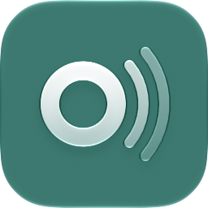
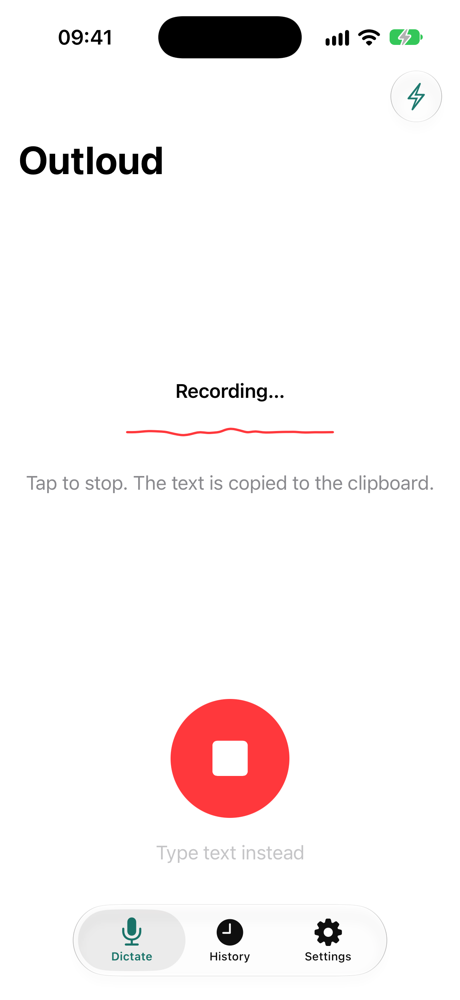

<p align="center">
  
</p>

<h1 align="center">Outloud — free, open-source offline dictation for Mac and iPhone</h1>

<p align="center">
  <strong>Speak, and get finished text where you type. Speech to text that runs entirely on your device.</strong><br>
  No account, no cloud, no subscription, no word limit — a private, open-source alternative to Wispr Flow and Superwhisper.
</p>

<!-- When the iPhone app is in the App Store, replace "App Store: coming soon"
     below and in §"Get started on iPhone" with its link (docs/RELEASE.md §"iOS"). -->
<p align="center">
  <a href="https://github.com/maxnowack/OutLoud/releases/latest"><strong>Download for Mac</strong></a>
  ·
  <a href="#voice-to-text-on-iphone"><strong>iPhone</strong></a> — App Store: coming soon
  ·
  <a href="#outloud-compared-with-wispr-flow-superwhisper-and-apple-dictation">Comparison</a>
  ·
  <a href="#build-it-yourself">Build it yourself</a>
</p>

<p align="center">
  
</p>

---

Outloud is a dictation app for the Mac and the iPhone. You speak a message,
an e-mail or a note; Outloud turns it into text with
[NVIDIA Parakeet v3](https://huggingface.co/FluidInference/parakeet-tdt-0.6b-v3-coreml),
a fast speech-to-text model that runs offline on your device, and Apple's
on-device model tidies it up: punctuation, paragraphs, and no more
"um" and "uh". What you get is the text you meant to type — never a rewrite,
never a translation — in the app you are typing in.

## Why Outloud

- **Finished text, not a raw transcript.** Filler words go, punctuation and
  paragraphs are set, your words stay yours. You edit less after you speak.
- **Right where you type.** On the Mac the text is pasted into the field you
  were in — even if you switched away while Outloud was still working, it
  waits until you are back. On the iPhone it is on your clipboard without
  leaving the app you are in.
- **Private by design.** Speech recognition and cleanup run on your Mac or
  iPhone. Your voice and your text never leave the device, and Outloud works
  in flight mode.
- **Free, with no catch.** Open source under the MIT license: no account, no
  subscription, no weekly word limit, no paid tier, no tracking.
- **One app, two devices.** The same dictation and the same cleanup on the
  Mac and on the iPhone.
- **English and German.** Built and tested for both; the model understands
  25 European languages.

## Speech to text on Mac

Hold <kbd>⌥</kbd> <kbd>⌘</kbd>, speak, let go. A small glass pill at the
bottom of the screen shows that Outloud is listening, then working, and the
text appears in the app you are typing in — Mail, Slack, Notes, your editor,
a browser field.

- **Push to talk from anywhere.** Outloud lives in the menu bar and listens
  only while you hold the keys. Pressing another key in the first second — a
  shortcut like <kbd>⌥</kbd> <kbd>⌘</kbd> <kbd>D</kbd> — cancels the
  dictation, so your other shortcuts keep working. <kbd>⌥</kbd>
  <kbd>Space</kbd> and two similar shortcuts can be chosen instead.
- **The text follows its field.** Switch to another app or another chat while
  a dictation is processed, and Outloud pastes it when you are back in the
  field you started in. The next dictation can start at once.
- **Your clipboard stays yours.** After a paste, the clipboard holds what it
  held before. Password fields never receive a paste.
- **Music pauses while you speak** and plays on afterwards — no pressing play
  after every dictation.
- **A history** keeps your recent dictations with their audio, the
  transcript and the cleaned text, for as long as you set — one day by
  default, or not at all.
- **Opens at login and updates itself** through
  [Sparkle](https://sparkle-project.org). The download is signed and
  notarised by Apple.

## Voice to text on iPhone

Run a shortcut from any app — with the Action Button, Back Tap, the Control
Center, AssistiveTouch or Siri — speak, and run it again. The Dynamic Island
shows what Outloud is doing, the cleaned text lands on your clipboard, and
you never leave the app you are in.

<p align="center">
  
</p>

- **Dictate from any app.** "Start or Stop Dictation with Outloud" followed
  by "Copy to Clipboard" records in the background while the app you are in
  stays in front. The app's guide sets it up with you.
- **A Live Activity** in the Dynamic Island and on the Lock Screen shows the
  recording, the transcription, the cleanup and "Copied".
- **Or open Outloud** — from the Action Button, the Control Center or the
  Lock Screen — and tap the big record button.
- **Clean up any text.** Type or paste text into Outloud, or use the "Clean
  Up Text with Outloud" shortcut action after the keyboard's own dictation.
- **The same history** as on the Mac, kept only as long as you set.

## Outloud compared with Wispr Flow, Superwhisper and Apple Dictation

Most dictation apps either send your voice to a server, or charge for the
cleanup, or run on only one of your devices. Outloud does none of the
three. It also does fewer things on purpose: dictation and cleanup — no
cloud modes, no AI rewriting, no custom keyboard.

| App | Speech processed | Mac | iPhone | Price | Open source |
| --- | --- | :---: | :---: | --- | --- |
| **Outloud** | **On device only** | ✓ | ✓ | **Free** | **Yes (MIT)** |
| [Apple Dictation](https://support.apple.com/guide/mac-help/use-dictation-mh40584/mac) | On device or Apple's servers, depending on device and language | ✓ | ✓ | Free, built in | No |
| [Wispr Flow](https://wisprflow.ai/pricing) | Cloud | ✓ | ✓ | Free up to 2,000 words a week on desktop; Pro $15/month | No |
| [Superwhisper](https://superwhisper.com/docs/billing/plans.md) | On device or cloud | ✓ | ✓ | Free tier; Pro $8.49/month or $249.99 lifetime | No |
| [Aqua Voice](https://aquavoice.com/pricing) | Cloud | ✓ | ✓ | Free up to 1,000 words; Pro from $10/month | No |
| [VoiceInk](https://tryvoiceink.com/) | On device; optional cloud enhancement | ✓ | Beta | From $25 one-time | Yes (GPL-3.0) |
| [MacWhisper](https://www.macwhisper.com/) | On device; cloud with your own API keys | ✓ | — | Free; Pro €64 one-time | No |
| [Ghost Pepper](https://github.com/matthartman/ghost-pepper) | On device | ✓ | — | Free | Yes (MIT) |

Prices and features as published by each vendor in October 2026; they
change, so check the linked pages.

### Pros and cons

| App | Pros | Cons |
| --- | --- | --- |
| **Outloud** | Free and open source; on device on both Mac and iPhone; cleanup included; no keyboard of its own to install — you keep yours, and no third-party keyboard gets full access; the finished text arrives in one piece, so the text field does not grow and jump while you speak; the text follows its field on the Mac; a history with audio | Needs macOS 27 or iOS 27; the cleanup needs Apple Intelligence; on the iPhone the text comes through the clipboard, so you paste it yourself; not yet in the App Store; no Windows or Android; built for English and German; no custom AI modes |
| Apple Dictation | Built in, nothing to install; many languages; types while you speak | Cleanup limited to punctuation; its new AI model in macOS and iOS 27 needs recent hardware (M3 with 12 GB, iPhone 17 Pro or Air); no history |
| Wispr Flow | Polished; Mac, Windows, iPhone and Android; an iPhone keyboard | Transcribes in the cloud, always; free tier capped at 2,000 words a week on desktop; subscription for more |
| Superwhisper | Local and cloud models; custom AI modes; Mac, Windows, iPhone and Android; lifetime licence | Parakeet and the cloud AI modes only in Pro; closed source |
| Aqua Voice | Own speech model; all four platforms; an iPhone keyboard | Cloud only; free tier capped at 1,000 words; subscription for more |
| VoiceInk | Open source; transcribes on device; one-time price | Paid; the iPhone app is in beta; its enhancement can use the cloud |
| MacWhisper | Local Whisper and Parakeet models; AI cleanup with your own API keys or a local model; one-time Pro price | Cleanup needs your own keys or a local model server; Pro is paid; closed source |
| Ghost Pepper | Free and open source; on device; a choice of speech models and a local language model for cleanup | Mac only, no iPhone app |

**In short:** pick Wispr Flow or Aqua Voice for Windows and Android,
Superwhisper or MacWhisper for custom AI modes and cloud models, Ghost
Pepper for a Mac-only setup with a local language model of your choice.
Pick Outloud for private, free dictation that works the same on your Mac
and your iPhone. Outloud's cleanup prompt started from Ghost Pepper's —
thank you.

## Get started on Mac

**Requirements:** macOS 27 on a Mac with Apple silicon. The cleanup needs
Apple Intelligence; without it, Outloud gives you the plain transcript.

1. Download `Outloud-<version>.zip` from the
   [latest release](https://github.com/maxnowack/OutLoud/releases/latest),
   unzip it and move **Outloud** to your Applications folder.
2. Open it. Outloud lives in the menu bar, not in the Dock. The first
   launch offers the speech model for download (483 MB, once) and asks for
   the microphone.
3. Grant **Accessibility** access when asked (System Settings › Privacy &
   Security › Accessibility). Outloud needs it to notice <kbd>⌥</kbd>
   <kbd>⌘</kbd> and to paste for you; until then, hold <kbd>⌥</kbd>
   <kbd>Space</kbd> instead, and the text lands on the clipboard.
4. Hold <kbd>⌥</kbd> <kbd>⌘</kbd>, speak, release.

## Get started on iPhone

**Requirements:** iOS 27. The cleanup needs Apple Intelligence.

**App Store: coming soon.** Until then, the iPhone app is in a closed beta
on TestFlight. Once it is installed:

1. Open Outloud once and download the speech model.
2. In the Shortcuts app, create a shortcut with the action **Start or Stop
   Dictation with Outloud**, followed by **Copy to Clipboard**. The app's
   guide walks you through it.
3. Put the shortcut where your thumb is: the Action Button, Back Tap,
   AssistiveTouch, the Control Center or Siri.
4. In any app, run the shortcut, speak, and run it again. The text is on
   your clipboard.

## FAQ

**Is Outloud free?**
Yes. Outloud is open source under the MIT license, with no subscription, no
paid tier and no word limit.

**Does Outloud work offline? Does my audio leave the device?**
After the one-time model download, dictation and cleanup run without an
internet connection. Your voice and your text never leave your Mac or
iPhone; there is no account, no tracking and no analytics.

**Is Outloud a free Wispr Flow alternative?**
Yes, for dictation on the Mac and the iPhone: hold a key or run a shortcut,
speak, get cleaned-up text where you type. Unlike Wispr Flow, Outloud
transcribes on your device instead of in the cloud, needs no account and has
no weekly word limit. It does not run on Windows or Android.

**Is Outloud a free Superwhisper alternative?**
For everyday dictation, yes. Outloud transcribes with Parakeet on your
device — a model Superwhisper offers in its Pro plan — and cleans the text
up on the device too, for free. It has no custom AI modes and no cloud
models.

**How is it different from Apple Dictation?**
The built-in dictation of macOS and iOS types while you speak. Outloud
listens first, then hands you finished text: filler words removed,
punctuation and paragraphs set. You start it from any app without switching
to the keyboard, it pastes into the field you were in, and a history keeps
your recent dictations.

**Which languages does it understand? Funktioniert Outloud auf Deutsch?**
Parakeet v3 recognises 25 European languages. Outloud is built and tested
for **English** and **German** — ja, Diktieren auf dem Mac und auf dem
iPhone funktioniert auf Deutsch, und die Oberfläche spricht beide Sprachen.

**Does Outloud read text aloud?**
No. Despite the name, Outloud is speech to text: you speak, it writes.

**Do I need Apple Intelligence?**
Only for the cleanup. Without it, Outloud gives you the plain transcript.

**Why does it need Accessibility access on the Mac?**
To notice <kbd>⌥</kbd> <kbd>⌘</kbd> while another app is in front, and to
paste the text into it. Outloud records only while you hold the keys.

## Build it yourself

You need Xcode 27.1 and [XcodeGen](https://github.com/yonaskolb/XcodeGen)
(`brew install xcodegen`).

```sh
cd apps/macos            # or apps/ios
xcodegen generate
open Outloud.xcodeproj
```

Each unit — `OutloudKit/`, `apps/macos/`, `apps/ios/` — has a full check
in `./scripts/precommit`, run from its directory: build with warnings as
errors, format lint, tests. `docs/RELEASE.md` describes how a release is
signed and published.

## Status

The Mac app is at version 0.4.0, published as a
[GitHub release](https://github.com/maxnowack/OutLoud/releases/latest);
the iPhone app is in a TestFlight beta. What the first version covers, and
what is still open, is in `plans/FIRST_VERSION.md` §"Status".

## For contributors

The repository is worked on by people and coding agents under the same
rules. Where to start:

1. `AGENTS.md` — the working rules.
2. `docs/SPEC.md` — what the product does.
3. `docs/adr/README.md` — the decisions.
4. `plans/FIRST_VERSION.md` — the plan of the first version.
5. The area files of the units: `OutloudKit/AGENTS.md`,
   `apps/macos/AGENTS.md`, `apps/ios/AGENTS.md`.

### What is here

| Path | What it is |
| --- | --- |
| `AGENTS.md` | The repository-wide working rules, the map of rule files and the map of living documents. |
| `CLAUDE.md` | A pointer to `AGENTS.md`, for harnesses that read that name. |
| `LICENSE` | MIT. |
| `OutloudKit/` | The shared Swift package: models, downloads, transcription, cleanup, settings, history, the interface components, and the `outloud` developer CLI. |
| `apps/macos/` | The macOS menu bar app, with its end-to-end plans in `e2e/`; its Xcode project is generated from `project.yml`. |
| `apps/ios/` | The iOS app, with its end-to-end plans in `e2e/`; its Xcode project is generated from `project.yml`. |
| `apps/shared/` | What both apps build from: the app icon (`AppIcon.icon`, `docs/DESIGN.md` §"App icon") and the release scripts' shared parts. |
| `docs/SPEC.md` | What the product does. |
| `docs/ARCHITECTURE.md` | Components, trust boundaries and data. |
| `docs/DESIGN.md` | The visual style: tokens, components, screens, the app icon. |
| `docs/RELEASE.md` | Versioning, release and rollback, per app. |
| `docs/HORIZONTAL_SCALING.md` | The register of single-instance assumptions. |
| `docs/ARCHITECTURE_PRINCIPLES.md` | The technology-independent architectural rules. |
| `docs/RULE_WRITING.md` | How a rule is phrased and where it goes. |
| `docs/PROCESSES.md`, `docs/VERIFICATION.md`, `docs/COMMITS.md` | Situational working rules, read when `AGENTS.md` says so. |
| `docs/adr/` | Decision records with format and index. |
| `docs/images/` | Images for this README: `app-icon.png` is rendered from `AppIcon.icon` and is re-rendered when the icon changes (`docs/DESIGN.md` §"App icon"); `macos-dictation.gif` is a screen recording of the Mac app; `ios-recording.png` is a screenshot from the iOS Simulator. Re-take them when the screens they show change. |
| `plans/` | Open plans and their index; `plans/done/` for finished ones. |

The structure and the rule documents come from the `agents-template`
repository (commit `3bdf7b1`), adopted on 2026-10-22.

## License

[MIT](LICENSE) © 2026 Max Nowack
